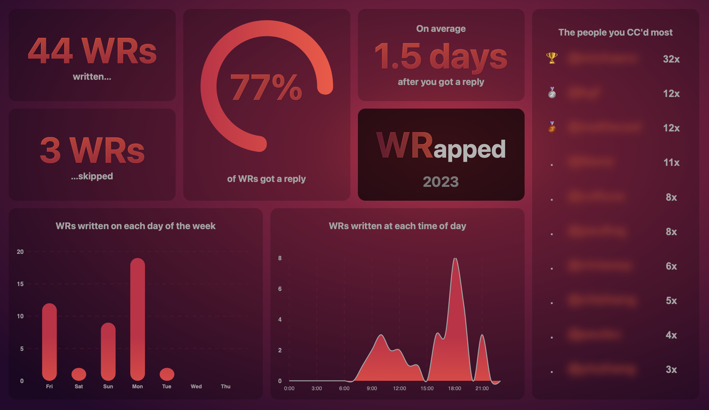

# WRapped

<div align="center">

  

</div>

## Description

This project is inspired by the yearly 'Spotify Wrapped', which is a summary of your listening habits over the past year. Wrapped does the same thing, but for Weekly reports a.k.a. WRs written by E-Mails. It is a simple script that parses your E-Mail inbox and outbox and generates statistics about your weekly reports. The statistic extraction is written in Rust, and the statistics are visualized by a web app that is served straight out of the binary.

## Getting Started

1. Install WRapped. On macOS and Linux:
    ```bash
    curl --proto '=https' --tlsv1.2 -LsSf https://github.com/fischeti/WRapped/releases/latest/download/wrapped-installer.sh | sh
    ```
    On Windows, in PowerShell:
    ```powershell
    powershell -ExecutionPolicy Bypass -c "irm https://github.com/fischeti/WRapped/releases/latest/download/wrapped-installer.ps1 | iex"
    ```
    Either way you end up with a single self-contained `wrapped` binary that you can run from anywhere. There is nothing to clone and no directory to run it from — see [A single binary](#a-single-binary). Other ways to install it are under [Installation](#installation).

2. Write a configuration file, which asks for your mail server and the addresses you sent the WRs between:
    ```bash
    wrapped init
    ```
    This writes `~/.config/wrapped/config.toml`. See the [Configuration](#configuration) section for everything it does not ask about.

3. Store your password in your keychain, so that you are not asked for it every time:
    ```bash
    wrapped login
    ```

4. Run the app to generate the statistics:
    ```bash
    wrapped
    ```
    which prints a summary to the terminal and automatically opens a browser window with the statistics.

## Installation

The installers above put the latest release into your `CARGO_HOME` (usually `~/.cargo/bin`). Pre-built binaries are available for:

| Platform | Targets |
| --- | --- |
| macOS | Apple Silicon and Intel |
| Linux | x86-64 and ARM64, against glibc |
| Windows | x86-64 |

Every [release](https://github.com/fischeti/WRapped/releases) also has the plain archives and their checksums attached, if you would rather download one yourself than pipe a script into a shell. Replacing `latest` in the URLs above with a tag such as `v0.1.0` installs that version instead of the newest one. What changed between releases is in the [changelog](CHANGELOG.md).

To build it yourself instead, which needs [Rust](https://rustup.rs):

```bash
cargo install --locked --git https://github.com/fischeti/WRapped.git
```

This builds whatever is on `main` rather than the latest release; `--locked` makes it use the dependency versions from `Cargo.lock`.

And to work on WRapped, clone the repository and use `cargo run -- <args>` in place of `wrapped <args>`.

## Usage

Without a subcommand, WRapped fetches your WRs and their replies, generates the statistics and shows them in your browser. The subcommands are there to debug your configuration:

| Subcommand | Description |
| --- | --- |
| `init` | Write a config file, asking for the account and the query |
| `login` | Store the password of your account in your keychain |
| `logout` | Remove the password of your account from your keychain |
| `mailboxes` | List all mailboxes of your account, to fill in the config file |
| `check` | Log in and list what the query matches, without generating statistics |

`wrapped check` is the one to reach for when a run comes back empty or looks wrong. It logs in, runs both queries, and lists the WRs and replies they match, so you can see whether the problem is the account or the query — a wrong `pattern`, `from`, `to`, `wr_mailboxes` or `--year` shows up as an empty list rather than as an error.

The most useful options are `--year <YEAR>` to pick a year other than the current one, `--config <FILE>` to use a config file other than the discovered one, `--addr <ADDR>` to serve the web app somewhere other than `127.0.0.1:8080`, `--no-open` to keep WRapped from opening a browser window, and `--stats-file <FILE>` to also write the statistics out as JSON. Run `wrapped --help` for the full list.

### A single binary

The web app — the HTML, the stylesheet, the JavaScript and a pinned copy of [D3](https://d3js.org) — is compiled into the binary by [`rust-embed`](https://docs.rs/rust-embed), and the statistics are served out of memory rather than written to disk. So `wrapped` needs no files next to it, runs from any directory, and draws its charts without a network connection.

Only release builds embed the files. A debug build (`cargo run`) reads `web/` from the checkout on every request instead, so that the app can be edited and reloaded in the browser without recompiling — which also means a debug binary only works from the checkout.

The statistics are not written anywhere unless you ask for them with `--stats-file <FILE>`, which is handy for looking at the numbers the web app is drawing:

```bash
wrapped --stats-file stats.json --no-open
```

### Where the config file is read from

`--config <FILE>` wins, then a `config.toml` in the working directory, then `~/.config/wrapped/config.toml` (or `$XDG_CONFIG_HOME/wrapped/config.toml`). Running from a checkout therefore keeps using a local `config.toml`, which is not tracked by git.

### Your password

The password is never read from the config file. WRapped looks for it in the `WRAPPED_PASSWORD` environment variable, then in your keychain, and asks for it otherwise. `wrapped login` puts it in your keychain after checking that it works, and `wrapped logout` takes it out again.

Colors are disabled automatically when the output is not a terminal, and when `NO_COLOR` is set.

## Configuration

The configuration file is written in [TOML](https://toml.io). `wrapped init` writes one for you; only four values have no default:

```toml
[account]
# The IMAP server to connect to (you can find this in your E-Mail client)
server = "my.mail.server"
# The username to log in with. WRapped asks for it if you leave it out.
username = "my_username"

[query]
# From which mail address you sent the WRs.
# Defaults to `username` when that is an address itself.
from = "my_username@my.mail.server"
# To which mail address you sent the WRs
to = "theboss@my.mail.server"
```

Everything else is optional, and only worth setting when the default does not fit:

```toml
[account]
# The port to connect to
port = 993

[query]
# The mailboxes to fetch the WRs you sent from,
# run `wrapped mailboxes` to list the ones you have.
wr_mailboxes = ["Sent"]
# The mailboxes to fetch the replies to your WRs from.
# Usually the INBOX is enough, but if a rule moves the
# replies somewhere else, name that mailbox here.
re_mailboxes = ["INBOX"]
# The patterns to match the subject of a WR against.
# This matches every subject containing "WR" OR "Weekly Report",
# so your subject has to be consistent over the years.
# At most two, which is a limitation of the IMAP search query.
pattern = ["WR", "Weekly Report"]
```

The year is not part of the configuration, it is `--year` and defaults to the current one. Neither is the password, see [Your password](#your-password). An unknown key is an error rather than being ignored, so a typo is reported on the line it is on.

## How it works

The script works by connecting to your E-Mail account using IMAP. It then searches for all E-Mails that match the given criteria. For instance it creates an IMAP search query that looks like this:

```
SUBJECT "WR" OR SUBJECT "Weekly Report" FROM "my_username@my.mail.server" TO "theboss@my.mail.server" SINCE "01-Jan-2023" BEFORE "01-Jan-2024"
```

which will return a sequence of E-Mail IDs. The script then fetches first the header (or `ENVELOPE` in IMAP terms) of each E-Mail, which contains information such as the date, the sender, the recipient, etc. In a second step, the content (or `BODY` in IMAP terms) is fetched and merged with the header to create a list of WRs.

The replies are fetched in a similar way, but the other way around:

```
SUBJECT "WR" OR SUBJECT "Weekly Report" FROM "theboss@my.mail.server" TO "my_username@my.mail.server" SINCE "01-Jan-2023" BEFORE "01-Jan-2024"
```

Each message contains a `IN-REPLY-TO` header, which contains the ID of the message it is replying to. The script then matches the replies to the WRs by comparing the `IN-REPLY-TO` header to the list of WRs.

Lastly, the script generates the statistics and serves them as JSON at `/stats/stats.json`, next to the web app itself. The web app then fetches that JSON and visualizes the statistics.

## License

This project is licensed under the MIT License - see the [LICENSE](LICENSE) file for details.
